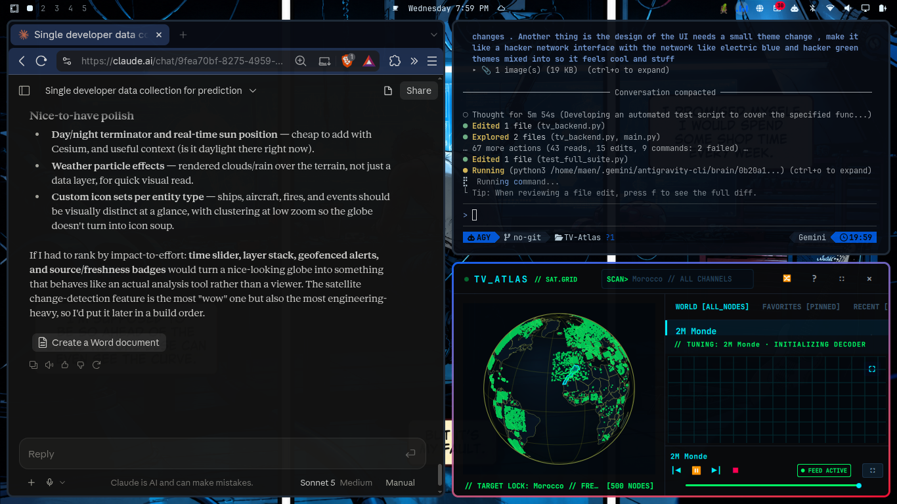

<div align="center">

# 📡 TV Atlas

### Global Television Explorer & Real-Time Cyber Terminal

[](https://python.org)
[](https://www.qt.io)
[](https://mpv.io)
[](https://kernel.org)
[](LICENSE)

*Explore and watch thousands of live, free-to-air television networks across the globe on an interactive 3D earth.*

<br/>



</div>

---

## 🌐 Overview

**TV Atlas** is a native desktop application that combines an interactive 3D orthographic globe with a hardware-accelerated broadcast video player. Designed with a cyber-terminal aesthetic (electric cyan and matrix phosphor green), it enables users to seamlessly explore global television signals, rotate the Earth with kinetic momentum, click transmitter locations, and stream international television networks directly inside the interface.

---

## ✨ Key Features

- **🌍 Interactive 3D Earth Globe**:
  - Drag or flick the globe with realistic kinetic momentum and smooth deceleration.
  - Deep mouse wheel zooming from orbital satellite view down to regional scale.
  - Orthographic spherical projection with country outlines, parallels, and meridians.
  - Hover detection and country targeting with instant telemetry feedback.
  - Transmitter beacons placed at genuine metropolitan broadcast centers.

- **📺 Over 15,000 Television Channels**:
  - Worldwide broadcast catalog spanning hundreds of countries and territories.
  - Instant tactical search (`SCAN>`) across all channel names, countries, callsigns, and categories.
  - Filter stations by genre: **News**, **Entertainment**, **Sports**, **Movies**, **Music**, **Science**, **General**.
  - Verified priority broadcast relays with high-reliability global uptime.

- **⚡ In-App Hardware-Accelerated Video Player**:
  - Embedded player powered by MPV via native window ID embedding (`--wid`).
  - Seamless stream switching without recreating playback windows or dropping frames.
  - Real-time video telemetry displaying live resolution (1080p, 720p, SD) directly from the decoder.
  - Full transport controls: Play/Pause, Next/Previous station, Stop, and volume slider.
  - Fullscreen Cinema Mode (`F` or `F11`) with automated viewport geometry synchronization.

- **💾 Dual-File Persistent Storage**:
  - Star stations with one click (`★` / `☆`) to pin them to your permanent **Favorites** tab.
  - Dual-file atomic storage ensuring favorites (`favorites.json`) and session history (`state.json`) survive unexpected shutdowns with durable `fsync`.

- **🛡️ Keyboard Shortcut Isolation**:
  - Seamless text input in the search bar without triggering navigation shortcuts (`F`, `M`, `Space`).

---

## 🛠️ System Requirements

- **Operating System**: Linux (X11 or Wayland via XWayland).
- **Python**: Version 3.9 or higher.
- **Dependencies**:
  - `PySide6` (Qt 6.5+)
  - `mpv` (v0.34+)

To verify prerequisites on your machine:
```bash
# Check Python and PySide6
python3 -c "import PySide6; print('PySide6 is ready')"

# Check mpv
mpv --version
```

---

## 🚀 Installation & Setup

### Option 1: One-Line System / User Install (Recommended)

Clone the repository and run the installer:

```bash
git clone https://github.com/MaenExists/TV-Atlas.git
cd TV-Atlas
./install.sh
```

The installer automatically:
1. Deploys the application files to `~/.local/share/tv-atlas-app`.
2. Creates the `tv-atlas` binary launcher in `~/.local/bin/tv-atlas`.
3. Installs high-resolution SVG and PNG app icons in standard system directories.
4. Registers the `.desktop` launcher so TV Atlas appears in your application launcher menu.

To uninstall:
```bash
./uninstall.sh
```

---

### Option 2: Run Directly from Source

You can run the application directly from the repository without system installation:

```bash
git clone https://github.com/MaenExists/TV-Atlas.git
cd TV-Atlas
pip install -r requirements.txt
./tv-atlas
```

---

### Option 3: Python Package Install

```bash
pip install .
tv-atlas
```

---

## ⌨️ Keyboard Shortcuts Reference

| Shortcut | Action |
|:---:|:---|
| <kbd>Space</kbd> | Toggle Play / Pause |
| <kbd>F</kbd> or <kbd>F11</kbd> | Toggle Fullscreen Cinema Mode |
| <kbd>M</kbd> | Toggle Mute |
| <kbd>R</kbd> | Tune to a random broadcast station anywhere on Earth |
| <kbd>/</kbd> | Focus the search input field (`SCAN>`) |
| <kbd>Esc</kbd> | Exit fullscreen mode or clear search filter |
| <kbd>?</kbd> | Toggle the on-screen keyboard shortcuts guide |

---

## 📂 Data & Configuration Directories

TV Atlas stores user preferences and cache files in standard XDG locations:

- **Favorites**: `~/.local/share/tv-atlas/favorites.json`
- **Session State & Volume**: `~/.local/share/tv-atlas/state.json`
- **Cache**: `~/.cache/tv-atlas/`

---

## 📜 Disclaimer & Legal Notice

TV Atlas is an open-source media directory and tuning player. It does not broadcast, host, or duplicate any streaming content on its servers. All broadcast signals are retrieved directly from publicly accessible, free-to-air transmissions made available by their respective broadcast networks. All trademarks, channel logos, and stream contents belong to their respective copyright holders.

---

## 📄 License

This project is licensed under the terms of the [MIT License](LICENSE).
